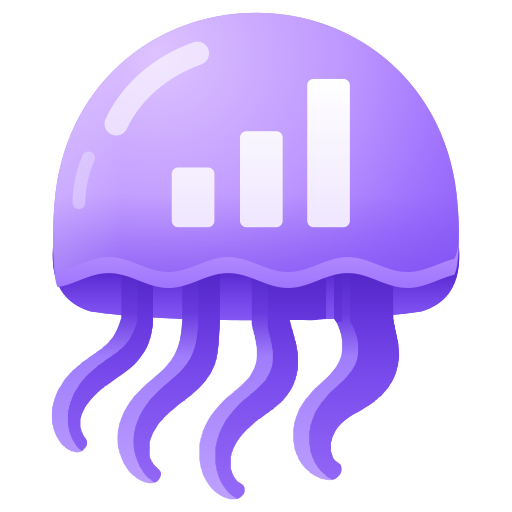

<p align="center"></p>

# JellyGlance Companion for Android

A native Android app (Kotlin + Jetpack Compose) for [JellyGlance](https://jellyglance.com): your Jellyfin server's streams, stats, requests, libraries and health in your pocket. A real APK, not a PWA.

## Features

**Everyday**
- **Home**: health, what's playing, today's numbers, quick actions, peak hours, disk runway, upcoming releases, recently added and pinned widgets. Shows the last saved data when the server can't be reached.
- **Streams**: every session with poster, viewer, device and progress. Send an on-screen message (the web's presets), stop now or stop with a reason, and pause/resume when Jellyfin is linked. Tells you when a client (e.g. Jellyfin Roku) can't take remote commands.
- **Requests**: Discover and search Seerr, request movies and seasons, and manage the queue: search, sort, filter by person/type/status, approve / decline / retry one or many, edit server, profile, folder, tags, 4K and seasons, reported issues, and request rules with per-person limits and auto-approve.
- **Activity**: play history with profile pictures and coloured device logos, Statistics (Overview, Recap, Taste map, Up next, Library health, Streams, Devices), Timeline, Transcodes and Recently added.
- **Title pages**: ratings (IMDb, Rotten Tomatoes, TMDB), seasons and episodes, play history, and "Open in Jellyfin app", which jumps the Jellyfin app on the phone straight to that title.
- **My Glance**: now playing, continue watching, watchlist, favourites, achievements, goals and your requests.

**Admin** (Owner / Admin accounts get an Admin tab)
- JellyGlance tasks, downloads, webhooks, integrations, backups, Wizarr invites, Jellyfin devices and plugins.
- Repair hub, reported issues, Jellyfin scheduled tasks, task logs, API keys, library tracking and activity-monitor intervals.

**Android**
- Sign in with your JellyGlance account (password or Jellyfin Quick Connect).
- Home-screen widgets: at a glance, Now playing (posters), Pending requests (Approve buttons) and Server health.
- Quick Settings tile, launcher shortcuts, and notifications for server problems, new streams and new requests (Approve / Decline from the notification).
- "Share to JellyGlance" from IMDb, TMDB, Letterboxd or a browser to request a title.
- Add upcoming releases to your calendar.
- App lock (fingerprint, face or screen lock), side rail on tablets, all 55 JellyGlance themes or your web theme, Material You.
- Updates itself from GitHub Releases, checking each download against its SHA-256.

## Install

Download `JellyGlance-Companion-vX.Y.Z.apk` from [Releases](https://github.com/JellyGlance/Companion-App/releases), open it on your phone and allow installing from that source. On first launch, sign in with your JellyGlance account.

After that the app keeps itself up to date: it checks the latest release daily (and when Home opens), shows "Update now", downloads the APK, checks it against the release's `.sha256`, and hands it to Android's installer. Settings > About > App updates has "Check now" and the automatic-check switch.

## Build

Requires JDK 17 and the Android SDK (platform 35).

```bash
./gradlew assembleDebug        # app/build/outputs/apk/debug/app-debug.apk
./gradlew assembleRelease      # signed when keystore.properties exists, else debug-signed
./gradlew testDebugUnitTest
```

`keystore.properties` (gitignored):

```
storeFile=keystore/jellyglance-release.jks
storePassword=...
keyAlias=jellyglance
keyPassword=...
```

## Releasing

1. Bump `versionCode` and `versionName` in `app/build.gradle.kts`, and add the release to `CHANGELOG.md`.
2. Tag and push: `git tag v1.0.1 && git push origin v1.0.1` (the tag must match `versionName`).
3. `.github/workflows/release.yml` tests, builds the signed APK, and publishes a release with `JellyGlance-Companion-v1.0.1.apk` and its `.sha256`. Installed apps see it within a day.

The repo needs the secrets `KEYSTORE_B64` (base64 of the .jks) and `KEYSTORE_PASSWORD`. Every release must be signed with that same key, or Android refuses the update.

To try the update flow from a debug build: `./gradlew assembleDebug -PupdateRepo=owner/repo -PupdateTest=true`.

## How it talks to JellyGlance

Signed in, the app uses your JellyGlance session (a Bearer token) on the same routes the web dashboard uses; an API key still works for the widget routes. Streams can also be controlled through Jellyfin directly once you link Jellyfin with Quick Connect (Settings or a title's menu).

JellyGlance is a separate project; this app is unofficial. MIT licensed. Brand logos from [Simple Icons](https://simpleicons.org) (CC0), Poppins under the SIL Open Font License.
